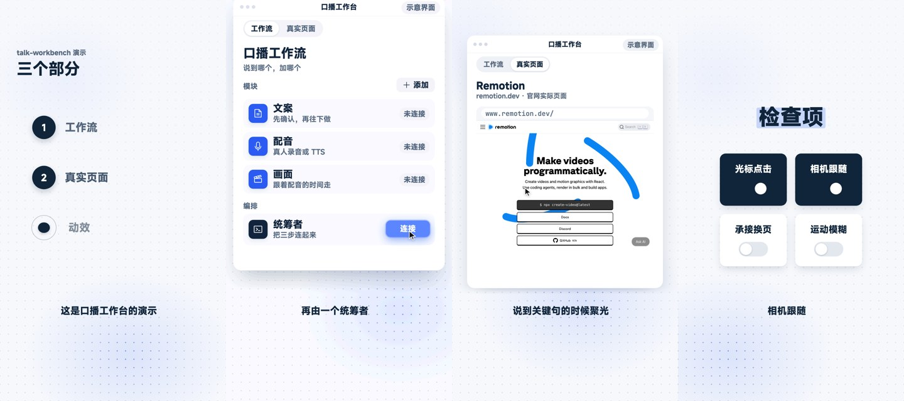

# 口播工作台 talk-workbench

把确认好的讲解配音做成「场景 + 工作台」交替的竖屏视频。

**v1.2（2026-10-24）：把作者 10 月 14 日到 23 日实际出片后定下的做法补进来。**

- 大字的新规矩：同一句话不在屏幕上出现两遍。大字只留 2–4 个字的核心词，能换数字图形就换；画面已经在讲的镜头不出大字。配置检查会提醒照抄字幕、字数超了。
- 整屏色块章节卡 `flood`：章节切换时色块铺满、巨字砸入，卡上的字不再重复出字幕。
- `scene` 新增十几种组件：终端重绘 `terminal`、截图推镜 `slides`、选择题 `poll`、放大镜分屏 `split`、对 Agent 说的一句话 `prompt`、流程图标 `flow`、整屏动画素材 `film`（可往屏幕里放视频、往空白牌面上叠字）、账单 `bill`、文件卡 `file` 等。
- 写稿前三问、逐句配音核对、动画交接说明、最终响度补增益，写进了工作流说明；节奏与镜头规则见方案 D 说明。
- 长标题缩小 `header.size`、整期固定底色 `canvas`；示例成片按新规矩重渲染。

**v1.1 更新依据：作者在 Obsidian 中于 2026-10-13 确认的方案 D。**
讲是什么、为什么和结论时用概念场景；演示操作时进入示意工作台，光标与相机跟随真实配音。
本版补入大纲球、概念场景、按钮悬停与弧线光标、三道检查，以及从文案到交付的工作流说明。

下面的联系表和成片是方案 D 演示（v1.2 重渲染，大字只留核心词）：大纲球收成卡片长出工作台，工作台里讲清单和真实页面，最后用概念场景收尾。



完整示例成片：[assets/demo.mp4](assets/demo.mp4)（26 秒：大纲 → 工作台两页 → 概念场景）

## 它是什么

- 一个 **AI skill**（`SKILL.md`）：装进 Claude Code、Codex 这类能读 skill 的 agent 之后，说「用口播工作台做这期视频」，它会按流程做。
- 一个 **Remotion 组件库**（`template/`）：不用 AI 也能直接用，一期视频就是一个 `episode.json`。
- 一套**视觉和动效规范**（`references/`）：颜色、字号、光标、相机、承接、验收清单。

适合：AI 工具介绍、工作流讲解、操作步骤、Skill 合集及其中的观点和结论。真人原片的修字删词先由独立剪辑工具完成。

## 它不做什么

- **不生成配音。** 配音是输入，真人录音或任何 TTS 都可以。
- **只有竖屏**（1080×1920，30fps）。横屏不在这一版范围内。
- **不含开场和结尾的角色素材。** `orb` / `opener` / `host` / `outro` 如需角色或头像，由使用者自备；无角色可直接用大纲或概念场景。

## 三步跑起来

需要 Node.js 18 以上、Python 3、ffmpeg。生成联系表还需要 Pillow；转写所需 Python 依赖已汇总到 `template/requirements.txt`。

```bash
git clone https://github.com/Nealsun1993/talk-workbench.git
cd talk-workbench/template
npm install && npm run setup      # 装依赖、复制字体
python3 -m pip install -r requirements.txt
```

预览示例：

```bash
npm run studio                    # 浏览器里实时预览
bash scripts/contact.sh demo 1.2 8.2 12.8 20.6     # 出联系表到 out/
npx remotion render src/index.tsx Episode out/demo.mp4 --props='{"episode":"demo"}'
```

## 做自己的一期

**1. 准备配音，生成骨架**

```bash
pip install -r requirements.txt  # 含转写、波形和联系表依赖；固定兼容的 PyAV 范围
python3 scripts/from_audio.py 我的配音.wav my-episode
```

得到 `public/episodes/my-episode/episode.json`：字幕、按句切好的镜头、每个字的时间（`_words`）。
转写会有同音错字，先通读一遍字幕，把专有名词改对。

**2. 给每个镜头选页面模板**

| 这一段在讲 | 用 |
|---|---|
| 开场大纲（角色可选） | `orb` |
| 概念、观点、结论 | `scene` |
| 用到哪几样东西 / 有哪几步 | `app.modules` |
| 一个 GitHub 仓库、官网、文档 | `app.browser` |
| 几项能力、检查项 | `app.toggles` |
| 节奏、时间轴 | `app.timeline` |
| 文字转配音 | `app.tts` |
| 生成结果、样图画廊 | `app.gallery` |
| 角色一致性 | `app.character` |
| 合成、导出 | `app.export` |
| 下期预告 | `app.draft` |

每个模板的画面和字段见 [references/templates.md](references/templates.md)，照着 `public/episodes/demo/episode.json` 改最快。

**3. 填关键词时间**

每个动作的 `at`，填配音里说到那个词的时间，从 `_words` 里查。不要估。

**4. 出联系表检查，再渲染**

先按 [方案 D](references/scheme-d.md) 写镜头变化与交接表，再按 [验收清单](references/checklist.md) 检查。

```bash
python3 scripts/lint_episode.py my-episode
# 完成实际渲染后：
python3 scripts/motion_audit.py out/my-episode.mp4 --episode my-episode --json out/my-episode-motion.json
python3 scripts/seam_sheet.py out/my-episode.mp4 my-episode
```

三道检查分别查看配置、成片动态和接缝附近抽样帧；不是“一键判断视频合格”。逐条核查异常，人工连续试听和手机裁切仍需完成。

从文案和声音开始的完整分工见 [工作流说明](references/workflow.md)。VoxCPM、video-talkcraft、Omni 是按需外部环节，本仓库不内置模型、账号或生成 API。

## 这套画面的几条规矩

| | |
|---|---|
| **示意界面** | 窗口标题栏常驻「示意界面」。它是讲解用的示意 App，不冒充任何真实软件 |
| **真实性标签** | 真实页面标「xxx 实际页面」，原文照抄；样图标「作者示例」。没有实测，不演「测试通过」 |
| **颜色** | 工作台蓝色表示当前操作；场景蓝色作荧光笔、黑色作强调；橙色表示问题或行动号召 |
| **光标** | 只做和台词对应的动作，动作之间停住 |
| **相机** | 说到哪推近哪（1.1 到 1.45 倍），讲完拉回 |
| **承接** | 上一页被点的元素直接长成下一页，工作台内至少一半的换页优先这么做；场景间不自动承接 |
| **可读性** | 配音念到的字在画面上不小于 32px；截图小字聚光后抬成原文卡片 |
| **不重复** | 字幕已经念出来的整句不再打一遍大字；大字只留核心词或换成数字、图形 |

完整规范：[全流程](references/workflow.md) · [方案 D](references/scheme-d.md) · [视觉](references/style.md) · [动效](references/motion.md)

目前 orb / scene 没有自动运动模糊，场景间也不会自动完成对象承接；具体边界见方案 D 说明。

旧工程想保持原光标行为，可在 episode.json 顶层设置 `"motion": {"polish": false}`。已有 `app.*` 和卡片配置继续可用，第三方依赖版本保持不变。

## 当 skill 用

把整个仓库放进 agent 的 skill 目录即可，例如：

```bash
git clone https://github.com/Nealsun1993/talk-workbench.git ~/.claude/skills/talk-workbench
```

然后对 agent 说：「用 talk-workbench 把这条配音做成讲解视频」，并给它配音文件和确认过的文案。

## 目录

```
talk-workbench/
├─ SKILL.md              给 agent 读的流程和硬规则
├─ references/           视觉规范、动效规范、模板说明、验收清单
├─ template/             Remotion 工程
│  ├─ src/templates/     概念场景（含色块章节卡、终端、动画素材等组件）、大纲、角色与卡片模板
│  ├─ src/app/           窗口引擎：标签栏、光标、相机、承接；pages/ 下是 9 个页面模板
│  ├─ src/kit/           设计 token、背景、字幕、图标
│  ├─ scripts/           骨架、联系表、配置检查、动态检查、接缝图、图标
│  └─ public/episodes/demo/   完整示例
└─ assets/               示例联系表和成片
```

## 常见问题

**转写没转完 / 结尾漏字？**
`--prompt` 里的词如果正好是配音的结尾内容，Whisper 可能提前停。脚本会检查并自动去掉提示词重试。一般不用加 `--prompt`。

**骨架只切出一个镜头？**
转写没输出句号时，脚本按配音里的停顿切（默认 0.45 秒）。配音很连贯的话，用 `--pause 0.3` 调小。

**光标点歪了？**
工作台光标由模板根据内容计算；点歪先查关键词时间与承接锚点。scene 的 cursor 使用显式坐标，需要对照实际帧确认指尖落点。

**截图里的字太小？**
不要硬放大。给 `app.browser` 写 `focus.text`，那一句会被抬成一张原文卡片。

**想加图标？**
`node scripts/icons.cjs 图标名`，名字到 [phosphoricons.com](https://phosphoricons.com/) 查。

## 授权

本仓库代码和文档以 [MIT](LICENSE) 授权。

依赖各自的许可；内嵌图标的完整许可通知见 [THIRD_PARTY_NOTICES.md](THIRD_PARTY_NOTICES.md)：

- **[Remotion](https://www.remotion.dev/)**：个人和小团队免费，公司使用需要购买授权，详见 [remotion.dev/license](https://www.remotion.dev/license)。
- MiSans（小米字体，免费商用，安装时从 npm 包复制，不随仓库分发）
- JetBrains Mono（OFL）· Phosphor Icons（MIT）· rough.js（MIT）

示例里的 Remotion 官网截图仅用于演示「真实页面聚光」这个功能。示例旁白是作者本人的声音，由 VoxCPM 合成。

## 作者

尼尔.S。抖音搜「尼尔.S」。用这套做了视频，欢迎在简介里提一句。
